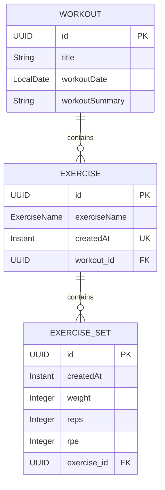

# Project Overview 📖 #
A RESTful backend for a personal workout tracker, built with Java and Spring Boot. 
The project grew from wanting a customizable way to track gym progress without relying on subscription-based apps. 
It organizes workouts, exercises, and sets, with support for workout notes.

# Current Features 📝 #
- Create, view, update, and delete workouts.
- Add exercises to workouts and retrieve exercises within their parent workout.
- Add exercise sets to exercises and retrieve sets within their parent exercise.
- Paginate workout and exercise lists with validated page numbers and page sizes.
- Validate incoming requests.
- Store workout data in PostgreSQL.

# Technology Stack 💻 #
| Technology | Purpose |
|---|---|
| Java and Spring Boot | Backend application and REST endpoints |
| Spring Data JPA / Hibernate | Database persistence and entity relationships |
| PostgreSQL | Workout data storage |
| Docker | Local PostgreSQL container |
| Maven | Build and dependency management |
| Postman | Manual endpoint testing |

# Data Model 📊 #



Each workout can contain zero or more exercises, and each exercise belongs to exactly one workout. Each exercise can contain zero or more sets, and each set belongs to exactly one exercise. `ExerciseName` is stored as an enum value rather than a separate entity.

Deleting a workout cascades to its exercises and their sets. Deleting an exercise cascades to its sets. Both parent collections use orphan removal. Sets record their creation timestamp and are ordered oldest first, with their ID breaking timestamp ties.

# API Endpoints 📲 #

All path IDs are UUIDs. Status codes below describe successful responses.

## Workouts

| Method | Endpoint | Description | Status |
|---|---|---|---|
| `POST` | `/api/v1/workouts` | Create a workout | 201 Created |
| `GET` | `/api/v1/workouts` | List a page of workouts, newest workout date first | 200 OK |
| `GET` | `/api/v1/workouts/{workoutId}` | Get a workout with its exercises | 200 OK |
| `PUT` | `/api/v1/workouts/{workoutId}` | Update a workout | 200 OK |
| `DELETE` | `/api/v1/workouts/{workoutId}` | Delete a workout | 204 No Content |

## Exercises

All endpoints below access exercises within the specified workout.

| Method | Endpoint | Description | Status |
|---|---|---|---|
| `POST` | `/api/v1/workouts/{workoutId}/exercises` | Add an exercise | 201 Created |
| `GET` | `/api/v1/workouts/{workoutId}/exercises` | List a page of exercises within a workout | 200 OK |
| `GET` | `/api/v1/workouts/{workoutId}/exercises/{exerciseId}` | Get an exercise with its sets | 200 OK |
| `PUT` | `/api/v1/workouts/{workoutId}/exercises/{exerciseId}` | Update an exercise | 200 OK |
| `DELETE` | `/api/v1/workouts/{workoutId}/exercises/{exerciseId}` | Delete an exercise | 204 No Content |

## Exercise Sets

All endpoints below access sets within the specified workout and exercise.

| Method | Endpoint | Description | Status |
|---|---|---|---|
| `POST` | `/api/v1/workouts/{workoutId}/exercises/{exerciseId}/sets` | Add a set with an automatically recorded creation timestamp | 200 OK |
| `GET` | `/api/v1/workouts/{workoutId}/exercises/{exerciseId}/sets` | List sets in creation order | 200 OK |
| `GET` | `/api/v1/workouts/{workoutId}/exercises/{exerciseId}/sets/{exerciseSetId}` | Get a set | 200 OK |
| `PUT` | `/api/v1/workouts/{workoutId}/exercises/{exerciseId}/sets/{exerciseSetId}` | Update a set | 200 OK |
| `DELETE` | `/api/v1/workouts/{workoutId}/exercises/{exerciseId}/sets/{exerciseSetId}` | Delete a set | 204 No Content |

## Pagination

The workout and exercise list endpoints accept optional query parameters:

| Parameter | Default | Allowed values |
|---|---|---|
| `page` | `0` | An integer greater than or equal to `0`; the first page is `0` |
| `size` | `10` | An integer from `1` to `20`, inclusive |

Examples (GET requests with no request body):

```http
GET http://localhost:8080/api/v1/workouts?page=0&size=20
GET http://localhost:8080/api/v1/workouts?page=1&size=20
GET http://localhost:8080/api/v1/workouts/{workoutId}/exercises?page=0&size=10
```

Replace `{workoutId}` with an existing workout UUID. Pass pagination values after `?`, separated by `&`. Use endpoint URLs without a trailing slash.

Workouts are sorted by workout date descending, then creation time descending. Exercises are sorted by creation time ascending, with ID ascending breaking timestamp ties.

Responses are JSON arrays containing up to `size` items. They do not include total elements, total pages, or other pagination metadata. A page beyond the available results returns an empty array (`[]`).

Pagination applies only to these list endpoints. The workout detail endpoint returns all exercise summaries, and exercise detail returns all sets. The exercise set list endpoint is also unpaginated and returns every set in creation order. Creation timestamps are stored internally and are not included in API responses.

Out-of-range values return `400 Bad Request` using the standard error response. For example, `?page=0&size=30` returns:

```json
{
  "statusCode": 400,
  "error": "size: must be less than or equal to 20"
}
```

Nonnumeric values such as `size=abc` also return `400 Bad Request`.

# Roadmap + Future Plans 💭 #
- Begin a IOS application which uses this REST API.
- Build a desktop app.
- Implement a sign up process for real users. 
