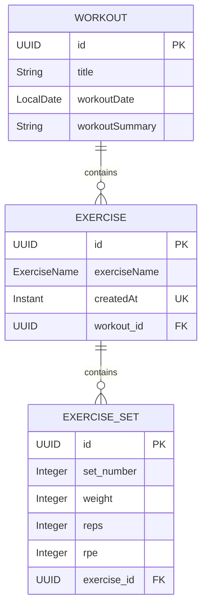

# Project Overview 📖 #
A RESTful backend for a personal workout tracker, built with Java and Spring Boot. 
The project grew from wanting a customizable way to track gym progress without relying on subscription-based apps. 
It organizes workouts, exercises, and sets, with support for workout notes.

# Current Features 📝 #
- Create, view, update, and delete workouts.
- Add exercises to workouts and retrieve exercises within their parent workout.
- Add exercise sets to exercises and retrieve sets within their parent exercise.
- Validate incoming requests.
- Store workout data in PostgreSQL.

# Technology Stack 💻 #
| Technology | Purpose |
|---|---|
| Java and Spring Boot | Backend application and REST endpoints |
| Spring Data JPA / Hibernate | Database persistence and entity relationships |
| PostgreSQL | Workout data storage |
| Docker | Local PostgreSQL container |
| Maven | Build and dependency management |
| Postman | Manual endpoint testing |

# Data Model 📊 #

Each workout can contain zero or more exercises, and each exercise belongs to exactly one workout. Each exercise can contain zero or more sets, and each set belongs to exactly one exercise. `ExerciseName` is stored as an enum value rather than a separate entity.

Deleting a workout cascades to its exercises and their sets. Deleting an exercise cascades to its sets. Both parent collections use orphan removal. The combination of `exercise_id` and `set_number` is unique, so set numbers cannot repeat within the same exercise.

# API Endpoints 📲 #

All path IDs are UUIDs. Status codes below describe successful responses.

## Workouts

| Method | Endpoint | Description | Status |
|---|---|---|---|
| `POST` | `/api/v1/workouts` | Create a workout | 201 Created |
| `GET` | `/api/v1/workouts` | List all workouts | 200 OK |
| `GET` | `/api/v1/workouts/{workoutId}` | Get a workout with its exercises | 200 OK |
| `PUT` | `/api/v1/workouts/{workoutId}` | Update a workout | 200 OK |
| `DELETE` | `/api/v1/workouts/{workoutId}` | Delete a workout | 204 No Content |

## Exercises

All endpoints below access exercises within the specified workout.

| Method | Endpoint | Description | Status |
|---|---|---|---|
| `POST` | `/api/v1/workouts/{workoutId}/exercises` | Add an exercise | 201 Created |
| `GET` | `/api/v1/workouts/{workoutId}/exercises` | List exercises | 200 OK |
| `GET` | `/api/v1/workouts/{workoutId}/exercises/{exerciseId}` | Get an exercise with its sets | 200 OK |
| `PUT` | `/api/v1/workouts/{workoutId}/exercises/{exerciseId}` | Update an exercise | 200 OK |
| `DELETE` | `/api/v1/workouts/{workoutId}/exercises/{exerciseId}` | Delete an exercise | 204 No Content |

## Exercise Sets

All endpoints below access sets within the specified workout and exercise.

| Method | Endpoint | Description | Status |
|---|---|---|---|
| `POST` | `/api/v1/workouts/{workoutId}/exercises/{exerciseId}/sets` | Add a set with an automatically assigned set number | 200 OK |
| `GET` | `/api/v1/workouts/{workoutId}/exercises/{exerciseId}/sets` | List sets in ascending set-number order | 200 OK |
| `GET` | `/api/v1/workouts/{workoutId}/exercises/{exerciseId}/sets/{exerciseSetId}` | Get a set | 200 OK |
| `PUT` | `/api/v1/workouts/{workoutId}/exercises/{exerciseId}/sets/{exerciseSetId}` | Update a set | 200 OK |
| `DELETE` | `/api/v1/workouts/{workoutId}/exercises/{exerciseId}/sets/{exerciseSetId}` | Delete a set | 204 No Content |

# Roadmap + Future Plans 💭 #
- Complete exercise set management.
- Containerize the Spring Boot application.
- Add automated service and controller tests.
- Build a web or mobile frontend.
- Add workout history and progress summaries.
- 
